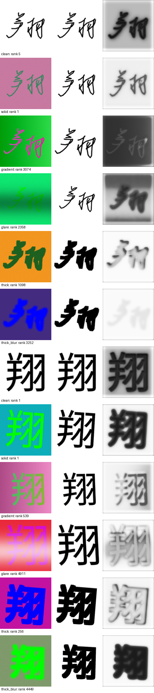
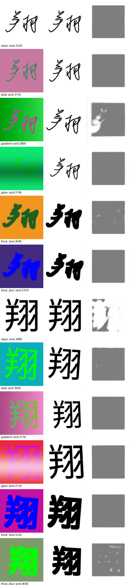

# 초소형 복원 모델 크기 비교

**결론: 이번 짧은 학습 예산에서는 채널을 늘려도 개선되지 않았다. 큰 모델이 아직 글자 복원을 배우지 못했으므로, 모델 용량의 최종 성능에 대한 결론은 낼 수 없다.**

50자 / 학습 원본 1,000개 / 검증 원본 50개 / 최종 평가 원본 100개. 모델 모두 처음부터 1 epoch, 63 업데이트씩 학습했다. 준비·두 모델 학습·평가 총 113.1초.

A: 채널 24→48→96→192, 1,095,553 파라미터. B: 48→96→192→384, 4,378,753 파라미터. 깊이와 입력 해상도는 같고 채널 폭만 바꿨다.

같은 학습 입력·정답·증강 seed·순서·batch 16·AdamW lr 0.001·초기화 규칙을 적용했다. 초기 파라미터의 모양이 달라 두 모델의 초기 가중치 값이 동일하다는 뜻은 아니다. 단일 seed이며 같은 계산 시간 비교가 아닌 같은 학습 횟수 비교다.

## 최종 평가

100개 원본 × 6조건 = 600개. 색/조명 변형은 절차적 합성이다. 이전 32개 사진 변형이나 실제 사진 정확도와 직접 비교할 수 없다.

|조건|A Top-1|A Top-10|B Top-1|B Top-10|정답 마스크 직접 입력 Top-1|
|---|---:|---:|---:|---:|---:|
|all|29.2%|35.2%|0.0%|0.0%|89.8%|
|clean|84.0%|95.0%|0.0%|0.0%|96.0%|
|solid|37.0%|41.0%|0.0%|0.0%|95.0%|
|gradient|13.0%|18.0%|0.0%|0.0%|94.0%|
|glare|17.0%|25.0%|0.0%|0.0%|94.0%|
|thick|13.0%|16.0%|0.0%|0.0%|81.0%|
|thick_blur|11.0%|16.0%|0.0%|0.0%|79.0%|

## 학습 및 검증

|모델|epoch|학습 시간|loss|검증 Top-1|검증 Top-10|
|---|---:|---:|---:|---:|---:|
|A|1|14.0초|1.4482|57.0%|67.0%|
|B|1|35.4초|1.5011|0.0%|0.0%|

## 해석과 제한

- 사전에 두 모델 모두 검증 Top-1 50% 미만이면 같은 3 epoch까지 늘리기로 고정했다. A가 57%여서 자동 연장은 하지 않았다. B의 실패를 본 뒤 평가 기준이나 학습량을 바꾸지 않았다.
- B 출력은 상당 부분이 균일한 회색 영역이고 글자와 배경의 구분이 되지 않는다. 획 내부 보존율이 높아도 배경까지 획으로 칠하면 인식에 도움이 되지 않으므로, 보존율만으로 성공을 판단하지 않는다.
- A도 최종 전체 Top-1 29.2%로 충분히 학습된 모델이 아니다. 1,000개·1 epoch에서 큰 모델이 더 잘된다는 근거를 얻지 못했을 뿐, 충분히 학습한 큰 모델이 더 나쁘다는 결론은 아니다.
- 굵기 조건은 128px 원본에 7×7 MinFilter를 적용해 256px 입력에서 획 폭을 약 12px 늘린다. 획이 합쳐질 수 있다. 정답 마스크 자체를 기존 인식기에 넣어도 이 조건의 성능이 떨어지므로 복원 모델 오류와 구분해야 한다.
- 다음 검증은 원본 수를 유지한 채 두 모델의 업데이트 횟수를 같은 기준으로 늘려 학습 곡선을 비교하는 것이다. 큰 모델의 학습률 민감도와 seed 차이도 별도 확인해야 한다. 이번에는 C(굵기 증강 학습)를 수행하지 않았다.
- 원본 그룹·픽셀 해시 분리 확인 및 계약 테스트 7개 통과. 기존 24분 실험의 체크포인트는 기본 채널 설정으로 그대로 로드된다. 앱 모델은 변경하지 않았다.

재현: `PYTHONPATH=tools/handwriting .venv/bin/python -m photo_restoration.micro_capacity`. 기존 출력 경로가 있으면 덮어쓰지 않도록 중단한다.

이미지 열 순서: 입력 / 정답 / 복원.

