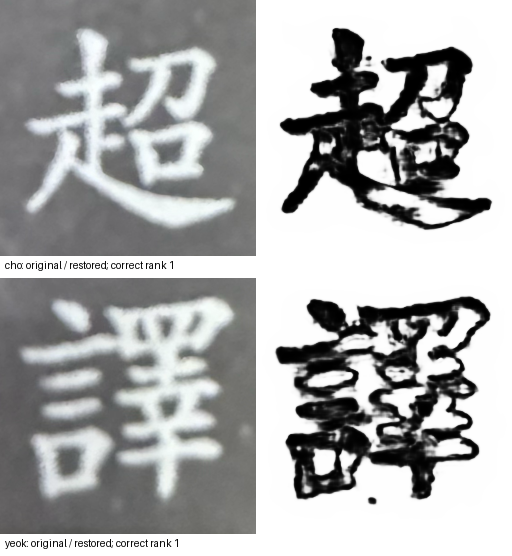
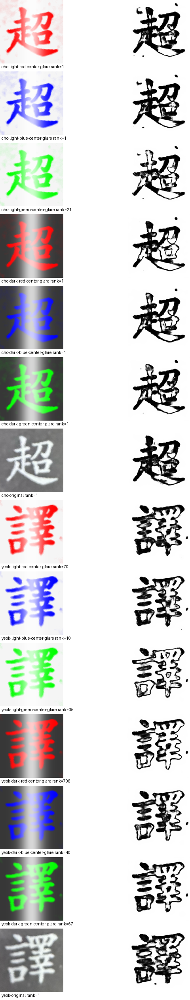
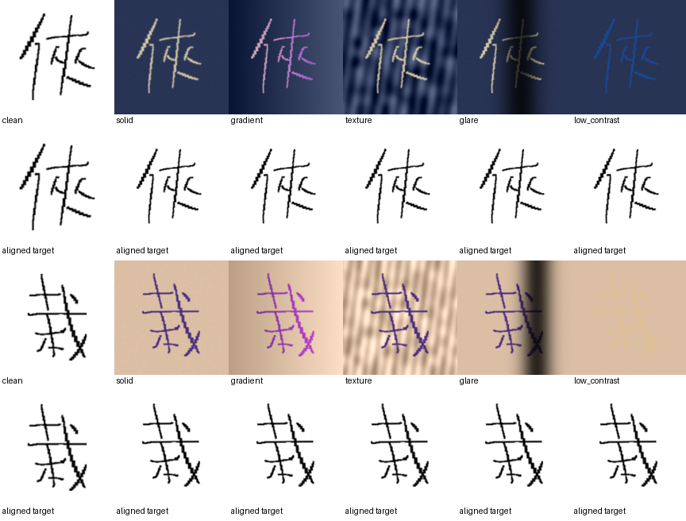
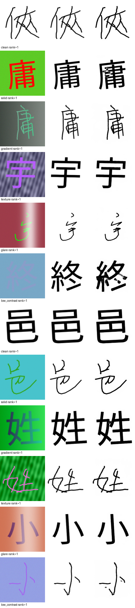

# 사진 획 복원 파일럿 결과

**판정: 합성 데이터에서 개선은 확인했지만, 기존 사진의 색상 변형에서 크게 실패해 현재 모델의 앱 적용은 보류한다.**

500자, 원본 20,000개 슬롯, 3 epoch. 매 epoch 1,000개 슬롯은 빈 배경으로 대체되어 실제 글자 원본 19,000개를 사용했다. 기존 한자 인식기는 고정했다.

선택된 체크포인트: epoch 3 (검증 Top-1, 동률 시 Dice). 준비·학습·검증·최종 평가 포함 23.7분.

최종 평가는 학습·검증과 원본 그룹 및 픽셀 해시가 겹치지 않는 1,000개 원본(500자)을 사용했다. 원본당 6조건, 총 6,000장. 같은 합성기에서 다른 seed로 만든 데이터이므로 실제 사진 일반화 성능을 뜻하지 않는다.

## 조건별 정답 1순위

|조건|장수|깨끗한 정답 입력|회색조|기존 흑백 방식|자동 반전 흑백|학습 복원|
|---|---:|---:|---:|---:|---:|---:|
|all|6000|96.9%|16.7%|37.2%|53.2%|95.3%|
|clean|1000|97.3%|97.3%|97.0%|97.0%|97.0%|
|glare|1000|96.6%|1.1%|9.0%|12.5%|95.7%|
|gradient|1000|97.0%|0.5%|13.5%|22.7%|95.5%|
|low_contrast|1000|96.8%|0.3%|39.0%|73.2%|92.3%|
|solid|1000|96.9%|1.0%|49.6%|90.7%|96.3%|
|texture|1000|96.8%|0.2%|15.2%|23.2%|95.2%|

## 색·배경·조명 변형만 비교 (clean 제외)

|처리|Top-1|Top-10|
|---|---:|---:|
|clean-target|96.8%|99.3%|
|gray-only|0.6%|1.5%|
|current-binary|25.3%|28.6%|
|auto-binary|44.5%|49.8%|
|restored|95.0%|98.7%|

자동 반전 흑백 대비 Top-1 차이: +50.5%p. 원본 단위 paired bootstrap 95% 구간 [+49.3, +51.8]%p. 합성기나 실제 촬영 환경의 불확실성까지 반영하는 구간은 아니다.

## 학습 경과

|epoch|loss|검증 복원 Top-1|검증 Dice|시간(분)|
|---|---:|---:|---:|---:|
|1|0.7258|94.6%|0.777|5.3|
|2|0.2779|96.8%|0.811|5.3|
|3|0.2517|96.8%|0.816|5.3|

## 글자 없는 배경 진단

별도 seed로 만든 빈 배경 600장 중 11장에서 foreground probability ≥ 0.5인 픽셀이 발생했다. 16픽셀 이상 나온 경우는 8장이다. 실제 사진에서 보정한 거부 기준이 아니며 배경 무늬에서 오검출이 남아 있다.

## 기존 사진 및 색상 변형 — 중요한 실패

|진단 대상|장수|자동 반전 Top-1|복원 Top-1|복원 Top-10|
|---|---:|---:|---:|---:|
|사진 원본 超·譯|2|100.0%|100.0%|100.0%|
|같은 사진의 색·배경·가운데 조명 변형|32|75.0%|31.2%|46.9%|

이 두 글자 사진은 복원 학습에는 쓰지 않았지만 이전부터 반복 관찰한 진단 자료이므로 독립 실사 정확도를 추정하는 자료가 아니다. 32개 변형의 자동 반전 결과가 과거 23/32와 달리 이번에는 24/32인 것은 256px 리사이즈 및 Python 전처리 경로가 다른 비교이기 때문이다. 위 표는 이번의 동일한 입력·평가 경로에서 비교했다.
관찰: 실제 사진 계열의 복원 결과에는 획 내부가 비거나 테두리만 남고, 얼룩이 발생한다. 특히 譯의 색상 변형에서 실패가 많다. 원인은 아직 확정하지 않았으며, 학습 이미지와 굵은 인쇄 글씨·실제 질감의 분포 차이가 후보이다.
다음 실험은 클래스 수만 늘리기보다 굵은 획·글자 크기·전경 내부 질감·실제 배경을 보강하고, 실제 사진 그룹으로 분리된 검증/테스트 세트를 확보하는 데 우선순위를 둔다. 현재 실패 사진은 개발용 회귀 사례로 유지하고 새 실제 사진을 최종 평가용으로 별도 확보한다. 이 파일럿 이후 추가 학습·배포는 수행하지 않았다.

## 재현 및 한계

- 실행: `PYTHONPATH=tools/handwriting .venv/bin/python -m photo_restoration.train`. 기존 체크포인트가 있으면 덮어쓰지 않고 중단한다. 새 실행은 --output으로 경로를 지정한다.
- 입력 RGB 256×256, 출력 soft mask, 최종 foreground cutoff 0.5는 test 이전 고정. 약 110만 파라미터, M4 Pro MPS FP32.
- 평가용으로 지정된 폰트 원본과 SCUT은 학습에서 제외했다. 각 클래스에서 가능하면 글꼴 1개와 SCUT 손글씨 1개를 평가했다. 별도 by_source 결과는 analysis.json에 포함한다.
- 학습과 검증의 원본 및 seed는 다르지만 배경 생성 규칙은 공유한다. 실제 재질 사진, JPEG, 원근·주변 글자 처리는 이번 파일럿에 포함하지 않았다.
- 후보 분류는 현재 앱 ONNX를 사용했다. 전처리는 Python/Pillow로 구현한 비교 경로이며 모바일 JPEG 변환·리사이즈와 완전히 동일한 실행 경로는 아니다. 앱 적용 전 Dart/ONNX parity 검증이 필요하다.
- 기존 2글자 사진과 32색상 변형은 known-photo-results.json의 별도 진단이며 독립적인 실사 평가가 아니다.
- 빈 배경 학습을 포함하지만 제품용 거부 임계값과 실제 사진 정확도는 아직 검증되지 않았다.
- 설정·원본 split·manifest hash·학습 이력·체크포인트·전체 예측을 같은 폴더에 보관했다. 앱 모델과 필기 경로는 변경하지 않았다.

