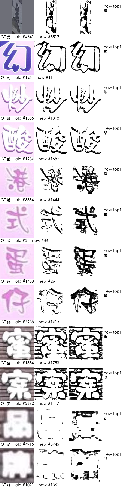
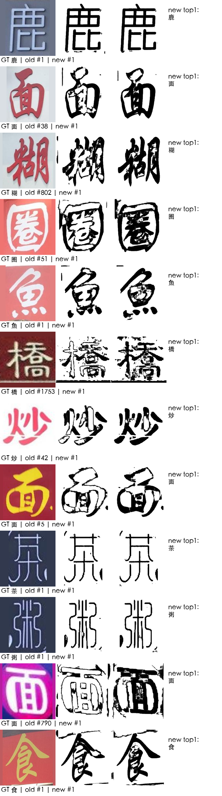

# ReCTS 실제 사진 500장 평가

## 결과

|전처리/모델|Top-1|Top-5|Top-10|
|---|---:|---:|---:|
|자동 반전·이진화|45.63%|55.59%|58.75%|
|이전 100회 복원 모델|0.81%|1.57%|1.96%|
|절반 굵기 증강 100회 복원 모델|2.63%|3.93%|4.65%|

## 평가 범위

- 공개 학습 세트 20,000장 중 seed 20261105로 무작위 500장 선택. 이 사진으로 학습하거나 설정을 조정하지 않았다.
- 500장 중 491장에서 지원 글자 4,449개, 서로 다른 한자 792종을 평가했다.
- 전체 라벨 10,668개 중 지원하지 않는 한자 2,291개와 숫자·영문 등 3,928개 제외. 정답 자형 변환 없음.
- 정답 글자 위치를 사용한 인식 평가다. 전체 사진에서 자동으로 글자를 찾는 검출 성능이나 공식 ReCTS 시험 점수는 아니다.
- 글자 바운딩 박스에 5% 여백을 붙이고 테두리 중앙값 색으로 정사각형 패딩 후 256px 입력. 모든 방법에 동일한 crop을 사용했다.
- 모델·인식기 고정, 복원 출력 임계값 0.5 유지. 개별 이미지 24개의 재추론 결과가 배치 평가 결과와 일치함을 확인했다.

## 해석

- 합성 평가의 높은 성능이 실제 간판 사진에 일반화되지 않았다. 이번 모델은 기존 자동 반전·이진화보다 크게 낮아 앱 적용에 적합하지 않다.
- 원인은 이 평가만으로 단정할 수 없다. 실제 배경·입체 글씨·조명·글자 크기와 여백 분포의 차이를 추가로 분리해 확인해야 한다.
- 복원 학습의 50자와 겹치는 127개에서도 새 모델 Top-1은 1.57%. 나머지 4,322개는 2.66%. 단순히 못 본 한자 때문만은 아니다.

## 출처와 재현

- 원본: https://datasets.cvc.uab.es/rrc/ReCTS.zip
- 공개 배포 안내: https://mmocr.readthedocs.io/en/v1.0.1/user_guides/data_prepare/recog.html#rects
- 다운로드: `PYTHONPATH=tools/handwriting .venv/bin/python -m photo_restoration.download_rects`
- 평가: `PYTHONPATH=tools/handwriting .venv/bin/python -m photo_restoration.evaluate_rects` (완료 출력 경로를 덮어쓰지 않음)
- 선택 표본·원본 파일 해시: resources/handwriting/datasets/rects-500/manifest.json
- 글자별 예측: predictions.jsonl / 전체 집계: result.json

이미지 열: 입력 / 이전 모델 / 이번 모델. 아래 정답과 순위를 표기.

